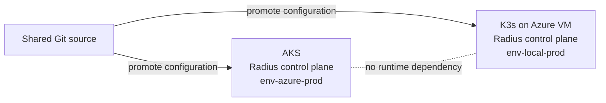
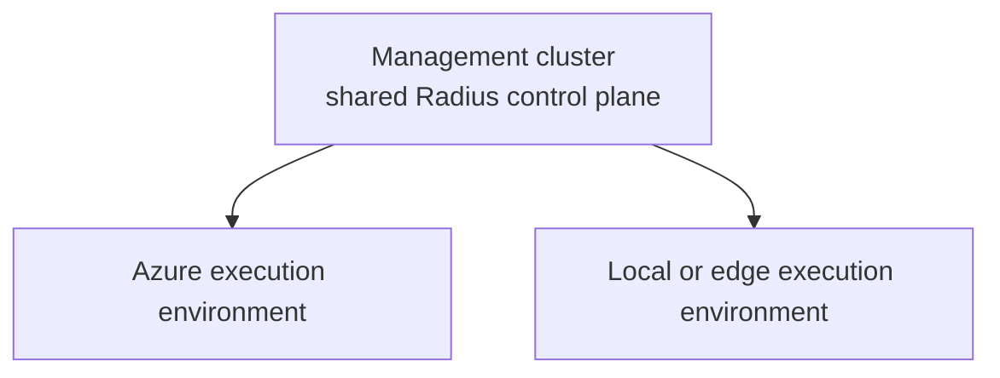

# Walkthrough Challenge 03 - Deploy and explore Radius

[< Previous Solution](https://github.com/microsoft/MicroHack/blob/main/03-Azure/01-01-App%20Innovation/04-adaptive-apps/walkthrough/challenge-02/solution-02.md) - **[Home](https://github.com/microsoft/MicroHack/blob/main/03-Azure/01-01-App%20Innovation/04-adaptive-apps/Readme.md)** - [Next Solution](https://github.com/microsoft/MicroHack/blob/main/03-Azure/01-01-App%20Innovation/04-adaptive-apps/walkthrough/challenge-04/solution-04.md)

Duration: 30-45 minutes per environment

## Coach notes

**LAB** means facilitator-provided infrastructure; **BYOS** means bring your own
subscription. For LAB, use the supplied resource names and **Option A: managed
identity** for Azure workload identity.

- The goal is to install, configure, and explore Radius on both default platforms.
- The default uses a **federated model**: one control plane on AKS and one on K3s.
- Only one team member runs each installation. Workspaces are local to each
  participant's workstation.
- Radius startup can take 5-10 minutes. Inspect pod state before rerunning commands.
- Always compare `kubectl config current-context` with the active Radius workspace.

## Tutorial: Connect to the lab resources

### 1. Initiate the connection from your dev container

Complete the [Challenge 03 connection setup](../../challenges/challenge-03.md#connect-to-the-lab-resources). It retrieves both clusters' credentials,
refreshes stale K3s credentials, and exports the shared variables via
`artifacts/lab-env.sh`. Do not repeat subscription/resource-group setup in each step.
In each new Bash terminal:

```bash
source artifacts/lab-env.sh
```

After a devcontainer restart, also rerun `bash resources/connect-lab.sh`.
The tunnel exposes only the Kubernetes API on localhost. Radius dashboard access still
uses `kubectl port-forward` through that API connection.

## Control-plane deployment options

### Federated control planes

Each site runs an independent Radius control plane:



Key characteristics:

- A site or WAN outage does not block the other site.
- Configuration is promoted independently from a shared source.
- Data synchronization is a separate application concern.
- The model fits edge, disconnected, and isolated failure-domain scenarios.

### Centralized control plane



Key characteristics:

- Governance and operations are centralized.
- Every site requires reliable connectivity to the management control plane.
- A control-plane outage affects all attached environments.

| Scenario | Typical choice |
| --- | --- |
| Single Azure region | Centralized |
| Azure plus always-connected datacenter | Centralized or federated |
| Azure plus intermittently connected edge | Federated |
| Disconnected or air-gapped site | Federated |
| Independent sites across a WAN | Federated unless shared connectivity and failure domains are acceptable |

The default AKS and K3s topology follows the federated model. K3s runs on an Azure VM
for workshop convenience but remains a self-managed Kubernetes platform.

## Understand the Radius hierarchy

### Control plane

A Radius control plane is installed once per Kubernetes cluster. It includes API
services, controllers, the Bicep deployment engine, UCP, CRDs, and the dashboard.

### Workspace

A workspace is local CLI configuration stored in `~/.rad/config.yaml`.

- One workspace targets one control plane.
- Switching workspace changes the destination of subsequent `rad` commands.
- Workspace configuration is per workstation, not stored in Kubernetes.

### Environment

An environment defines how and where applications are deployed:

- A Kubernetes namespace
- Optional cloud-provider configuration
- Recipe registrations added in later challenges

`env-azure-prod` can use Azure-backed recipes. `env-local-prod` has no Azure provider
and uses in-cluster implementations.

### Group

A Radius group is a logical container for applications and resources. It is not an
Azure resource group and has no Azure billing scope.

```text
Workstation rad configuration
|
|-- Workspace: ws-azure-prod
|   `-- AKS Radius control plane
|       `-- Environment: env-azure-prod
|           `-- Group: rg-trading
|               `-- Application: adaptive-apps
|
`-- Workspace: ws-local-prod
    `-- K3s Radius control plane
        `-- Environment: env-local-prod
            `-- Group: rg-trading
                `-- Application: adaptive-apps
```

## Manual tutorial: AKS

### 1. Select and verify AKS

```bash
unset KUBECONFIG
kubectl config use-context "$AKS_CONTEXT"
kubectl config current-context
kubectl get nodes
kubectl get namespace radius-system --ignore-not-found
```

### 2. Prepare Azure workload identity

The connection setup has already selected the subscription and exported the lab
resource names. Retrieve the identity settings from that AKS cluster:

```bash
export RADIUS_APP_NAME="${AKS_CLUSTER}-radius-app"

export OIDC_ISSUER="$(az aks show \
  --resource-group "$RESOURCE_GROUP" \
  --name "$AKS_CLUSTER" \
  --query oidcIssuerProfile.issuerUrl \
  --output tsv)"
export TENANT_ID="$(az account show --query tenantId --output tsv)"
```

Choose **one** identity option. Both use AKS OIDC federation with no client secret.
See Microsoft's [AKS workload identity guide](https://learn.microsoft.com/azure/aks/workload-identity-deploy-cluster)
for the managed identity and federated credential commands.

#### Option A: user-assigned managed identity (required for LAB; also supported for BYOS)

Create the identity inside the supplied lab resource group. These are Azure Resource
Manager operations, not tenant app/SP creation. The explicit principal object ID
in the role assignment below avoids a Microsoft Graph lookup.

```bash
export RADIUS_MANAGED_IDENTITY_NAME="${AKS_CLUSTER}-radius"
az identity create \
  --resource-group "$RESOURCE_GROUP" \
  --name "$RADIUS_MANAGED_IDENTITY_NAME" \
  --location "$AZURE_LOCATION" --output none

export IDENTITY_CLIENT_ID="$(az identity show \
  --resource-group "$RESOURCE_GROUP" \
  --name "$RADIUS_MANAGED_IDENTITY_NAME" --query clientId --output tsv)"
export IDENTITY_PRINCIPAL_ID="$(az identity show \
  --resource-group "$RESOURCE_GROUP" \
  --name "$RADIUS_MANAGED_IDENTITY_NAME" --query principalId --output tsv)"

for service_account in applications-rp bicep-de ucp dynamic-rp; do
  az identity federated-credential create \
    --resource-group "$RESOURCE_GROUP" \
    --identity-name "$RADIUS_MANAGED_IDENTITY_NAME" \
    --name "radius-${service_account}" \
    --issuer "$OIDC_ISSUER" \
    --subject "system:serviceaccount:radius-system:${service_account}" \
    --audiences api://AzureADTokenExchange --output none
done
```

Configure trust for all four Radius service accounts, including **both
`applications-rp` and `bicep-de`**, plus `ucp` and `dynamic-rp`, matching the recovery
script. If an identity/credential already exists, inspect it and update a mismatched
issuer or subject rather than deleting shared state. Then skip Option B and continue
at **Grant the identity access**.

#### Option B: Entra application (BYOS with tenant permissions only)

Create an Entra application and service principal. Do not run this option in LAB,
where permissions are limited to the assigned resource group:

```bash
export APPLICATION_CLIENT_ID="$(az ad app create \
  --display-name "$RADIUS_APP_NAME" \
  --query appId \
  --output tsv)"
export APPLICATION_OBJECT_ID="$(az ad app show \
  --id "$APPLICATION_CLIENT_ID" \
  --query id \
  --output tsv)"

az ad sp create --id "$APPLICATION_CLIENT_ID"

export IDENTITY_CLIENT_ID="$APPLICATION_CLIENT_ID"
export IDENTITY_PRINCIPAL_ID="$(az ad sp show \
  --id "$APPLICATION_CLIENT_ID" --query id --output tsv)"
```

For each Radius service account, create a federated credential. The example below is
for `applications-rp`; repeat it for `bicep-de`, `ucp`, and `dynamic-rp`, changing
both `name` and `subject`:

```bash
cat >radius-applications-rp.json <<EOF
{
  "name": "radius-applications-rp",
  "issuer": "${OIDC_ISSUER}",
  "subject": "system:serviceaccount:radius-system:applications-rp",
  "description": "Radius workload identity for applications-rp",
  "audiences": ["api://AzureADTokenExchange"]
}
EOF

az ad app federated-credential create \
  --id "$APPLICATION_OBJECT_ID" \
  --parameters @radius-applications-rp.json
```

#### Grant the identity access (both options)

Grant the Radius identity Owner on the isolated lab resource group only, because
recipes create role assignments. Allow identity/federation/RBAC propagation before
testing Radius; a newly created principal can take time to become available.

```bash
az role assignment create \
  --assignee-object-id "$IDENTITY_PRINCIPAL_ID" \
  --assignee-principal-type ServicePrincipal \
  --role Owner \
  --scope "/subscriptions/${AZURE_SUBSCRIPTION}/resourceGroups/${RESOURCE_GROUP}"
```

### 3. Install Radius on AKS

```bash
rad install kubernetes \
  --kubecontext "$AKS_CONTEXT" \
  --set global.azureWorkloadIdentity.enabled=true
```

If GHCR returns HTTP 403:

```bash
helm registry logout ghcr.io || true
docker logout ghcr.io || true
```

Then rerun the installation.

### 4. Create the AKS workspace and scopes

```bash
rad workspace create kubernetes ws-azure-prod \
  --context "$AKS_CONTEXT" \
  --force
rad workspace switch ws-azure-prod

rad group create rg-trading
rad group switch rg-trading

rad env create env-azure-prod \
  --group rg-trading \
  --kubernetes-namespace env-azure-prod
rad env update env-azure-prod \
  --azure-subscription-id "$AZURE_SUBSCRIPTION" \
  --azure-resource-group "$RESOURCE_GROUP"
rad env switch env-azure-prod

rad credential register azure wi \
  --client-id "$IDENTITY_CLIENT_ID" \
  --tenant-id "$TENANT_ID"
```

## Manual tutorial: K3s

### 1. Select and verify K3s

```bash
export KUBECONFIG="$K3S_KUBECONFIG"
kubectl config use-context "$K3S_CONTEXT"
kubectl config current-context
kubectl get nodes
kubectl get namespace radius-system --ignore-not-found
```

### 2. Install Radius on K3s

```bash
rad install kubernetes --kubecontext "$K3S_CONTEXT"
```

### 3. Create the K3s workspace and scopes

```bash
rad workspace create kubernetes ws-local-prod \
  --context "$K3S_CONTEXT" \
  --force
rad workspace switch ws-local-prod

rad group create rg-trading
rad group switch rg-trading

rad env create env-local-prod \
  --group rg-trading \
  --kubernetes-namespace env-local-prod
rad env switch env-local-prod
```

Do not register Azure credentials or an Azure provider for K3s.

## Validate and explore both environments

For each active kube context and matching Radius workspace:

```bash
kubectl wait --for=condition=Available deployments --all \
  --namespace radius-system \
  --timeout=10m
kubectl get pods --namespace radius-system
kubectl get crd recipes.radapp.io deploymenttemplates.radapp.io deploymentresources.radapp.io

rad workspace list
rad env list
rad group list
```

Open the dashboard:

```bash
kubectl port-forward service/dashboard \
  --namespace radius-system 7007:80
```

Browse to <http://localhost:7007>. Stop the port-forward, switch both kube context and
Radius workspace, and repeat for the other platform.

Discuss:

- Which objects live in the cluster and which live on the workstation?
- What happens to K3s applications if AKS is unavailable?
- Why can both sites use `rg-trading` without sharing a group?
- Which environment can provision Azure-managed resources, and why?

## Optional platforms

The same Radius installation principles apply when Azure Local or an existing
Arc-enabled cluster replaces K3s:

- [Azure Local preparation](https://github.com/microsoft/MicroHack/blob/main/03-Azure/01-01-App%20Innovation/04-adaptive-apps/docs/prepare-azure-local.md)
- [Azure Arc-enabled Kubernetes preparation](https://github.com/microsoft/MicroHack/blob/main/03-Azure/01-01-App%20Innovation/04-adaptive-apps/docs/prepare-arc.md)

Use the platform's active kube context, create a distinct Radius workspace, and decide
explicitly whether that installation needs an Azure provider.

## Optional automation

These scripts automate **Radius control-plane installation and post-configuration
on existing Kubernetes clusters**. They do **not** create or reinstall AKS, the
K3s Kubernetes installation, its VM, or networking. They do not deploy the portfolio,
recipes, or application workloads from later challenges.

The Radius environments `env-azure-prod` and `env-local-prod` are configuration
objects, not Kubernetes clusters; `rg-trading` is a Radius group, not an Azure
resource group.

For **LAB**, the facilitator supplies the Kubernetes infrastructure. For **BYOS**,
prepare it in Challenge 02 first. Both paths use the shared connection setup above
and `artifacts/lab-env.sh`. Run the following in Bash from the Adaptive Apps
MicroHack root. One team member installs each shared control plane; each participant
can rerun with `RADIUS_REINSTALL=false` to configure their own local workspace.

### AKS

**LAB and BYOS:** use managed identity for Radius workload identity. This is
required for LAB and also works for BYOS. The helper configures the identity,
federation, role assignment, Radius Azure credential/provider, workspace
`ws-azure-prod`, group `rg-trading`, and environment `env-azure-prod`.

```bash
source artifacts/lab-env.sh
unset KUBECONFIG
kubectl config use-context "$AKS_CONTEXT"
RADIUS_IDENTITY_MODE=managedidentity RADIUS_REINSTALL=false bash resources/deploy-radius-aks.sh
```

**BYOS only, with tenant permissions:** to use an Entra application/service principal
instead of managed identity, replace only the last command with:

```bash
RADIUS_IDENTITY_MODE=application RADIUS_REINSTALL=false bash resources/deploy-radius-aks.sh
```

### K3s

**LAB and BYOS:** use the same commands. The helper installs Radius if missing,
creates missing workspace/group/environment configuration, and validates it.
It does not register Azure credentials or configure an Azure provider.

```bash
source artifacts/lab-env.sh
export KUBECONFIG="$K3S_KUBECONFIG"
kubectl config use-context "$K3S_CONTEXT"

RADIUS_REINSTALL=false bash resources/deploy-radius-k3s.sh
```

The script waits for Radius readiness before configuring scopes. It creates any
missing `ws-local-prod`, `rg-trading`, and `env-local-prod`, selects them, and checks
the workspace's K3s context and the environment's `env-local-prod` namespace with
no Azure provider. Existing environments (including later recipe configuration)
are preserved; incompatible settings or failed queries stop setup with an error.

### Install versus reinstall (LAB and BYOS)

| Setting | Radius behavior on the selected, existing cluster |
| --- | --- |
| `RADIUS_REINSTALL=false` (all examples above) | Install Radius if missing; otherwise retain its control plane. Then run Radius post-configuration and validation in either case. |
| `RADIUS_REINSTALL=true` | Reinstall an existing Radius control plane, then run post-configuration and validation. This does not reinstall AKS or K3s. |

Keep the explicit `false` override for safe reruns: the AKS script's raw default is
`true`, while the K3s script's default is `false`. Neither setting skips Radius
post-configuration. Coordinate an intentional Radius reinstall with the team
because it can disrupt the shared installation.

Dashboard exploration and the team discussion remain manual.
